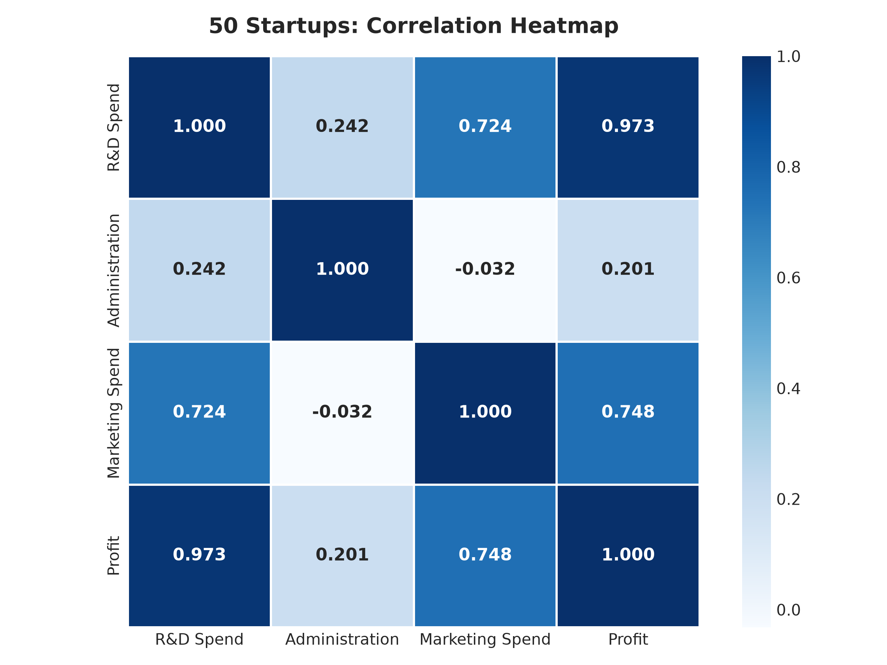
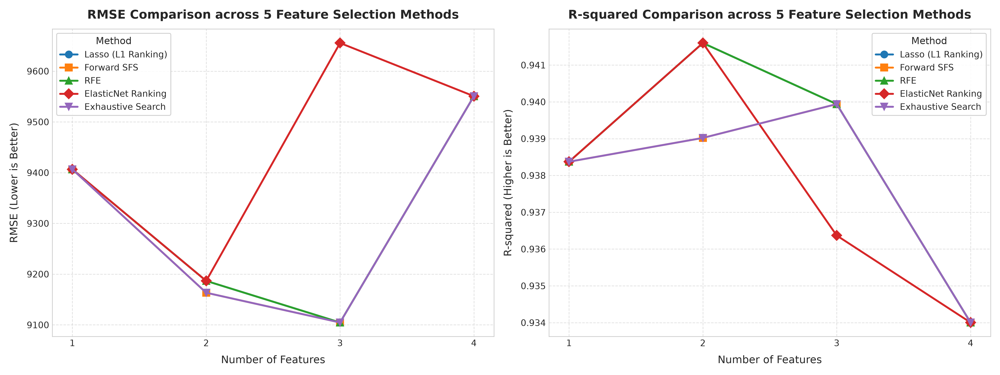
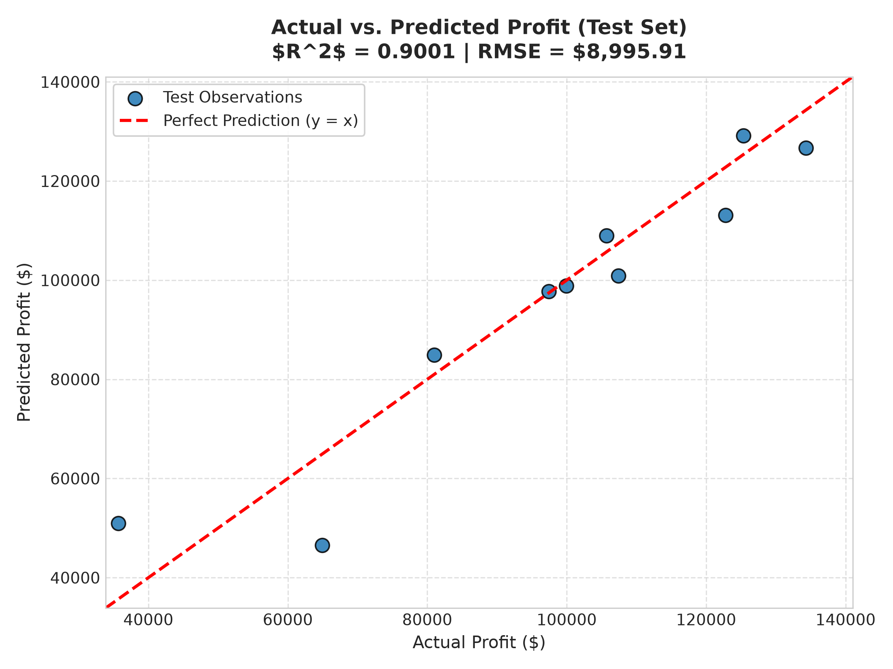
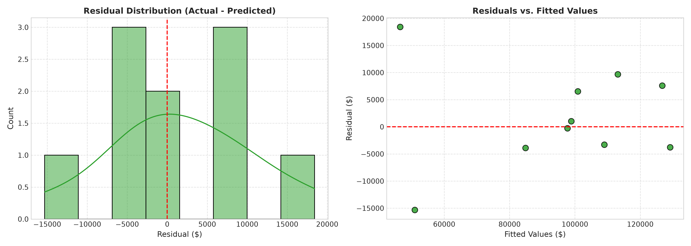
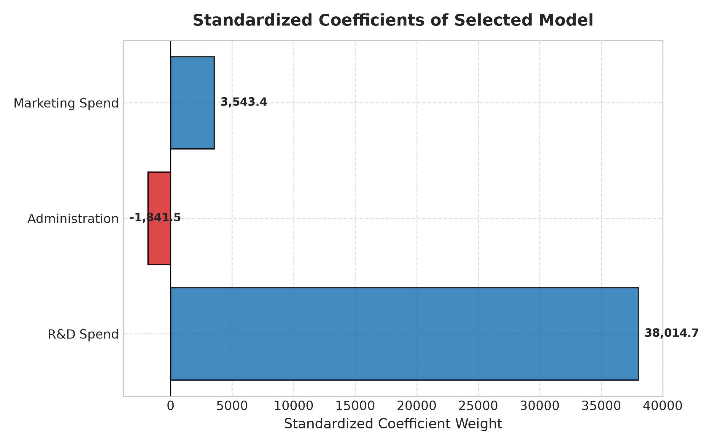

# 專案一：50 家新創公司利潤預測 (50 Startups Profit Prediction)

本專案為完全手動實現的機器學習流程，使用**多元線性迴歸 (Multiple Linear Regression)** 根據營運支出與地理位置來預測新創公司的年度利潤。

---

## 1. 專案概述與預測目標

本專案的主要目標是建立並評估多元線性迴歸模型，根據新創企業的三大營運支出：研發支出（`R&D Spend`）、行政管理支出（`Administration`）、市場行銷支出（`Marketing Spend`），以及企業註冊營運州別（`State`），來精確預測其年度淨利潤（`Profit`）。

透過比較五種不同的特徵選取方法（Lasso L1 排序、向前逐步選取 Forward SFS、遞迴特徵消除 RFE、ElasticNet 排序、窮舉搜尋 Exhaustive Search）並搭配 5 折交叉驗證（5-Fold Cross-Validation），深入探討哪些特徵真正主導新創公司的獲利能力，並剔除無顯著貢獻的雜訊變數以降低模型過度擬合與複雜度。

---

## 2. Kaggle 資料集來源與特徵說明

- **Kaggle 資料集來源：** [Kaggle 50 Startups Dataset](https://www.kaggle.com/datasets/farhanmd29/50-startups)
- **本地資料集路徑：** [`data/50_Startups.csv`](file:///c:/Users/user/Downloads/DIC_hw2/Kaggle_Multiple_Linear_Regression/Project_1_50_Startups/data/50_Startups.csv)
- **資料集規模：** 50 筆樣本，5 個欄位（4 個原始輸入特徵 + 1 個目標變數）。
- **預測目標變數：** `Profit`（連續型數值變數，單位：美元 USD）。

### 原始特徵詳細說明
| 特徵名稱 | 變數類型 | 說明 | 單位 / 數值範圍 |
| :--- | :--- | :--- | :--- |
| **`R&D Spend`** | 連續型 | 投注於產品研發與技術創新的年度支出 | 美元 ($) [0 ~ 165,349] |
| **`Administration`** | 連續型 | 內部行政、法務、管理與日常營運開銷 | 美元 ($) [51,283 ~ 182,646] |
| **`Marketing Spend`** | 連續型 | 市場開拓、客戶獲取、廣告與推廣支出 | 美元 ($) [0 ~ 471,784] |
| **`State`** | 類別型 | 公司註冊總部所在的州別 | California, Florida, New York |
| **`Profit`** *(Target)* | 連續型 | 企業年度營運淨利潤（目標變數） | 美元 ($) [14,681 ~ 192,262] |

---

## 3. 資料預處理與類別變數編碼

1. **缺失值檢查：**
   - 經檢查，全資料集 50 筆樣本皆無任何缺失值（Missing Values / NaN）。
2. **類別特徵獨熱編碼 (One-Hot Encoding)：**
   - 類別特徵 `State` 包含 3 個水準（California, Florida, New York）。
   - 為避免**虛擬變數陷阱 (Dummy Variable Trap)**（即虛擬變數與截距項之間產生的完全共線性），將 `California` 作為基準對照組並設定 `drop_first=True`，生成 `State_Florida` 與 `State_New York` 兩個編碼欄位。
   - 在特徵選取與排序過程中，`State` 被作為單一原始特徵群組進行一致性的篩選評估。
3. **資料分割與防止資料外洩 (Data Leakage Prevention)：**
   - 設定隨機種子確保結果可重現：`random_state=42`。
   - 將資料集依 80% / 20% 分割為**訓練集 (40 筆)**與**測試集 (10 筆)**。
   - 標準化轉換器 (`StandardScaler`) **嚴格僅在訓練集擬合 (fit)**，並在各交叉驗證折中僅對訓練折擬合後套用至驗證折與測試集，徹底杜絕資料外洩。

---

## 4. 探索性資料分析 (EDA)

數值變數與利潤的相關性分析揭示了關鍵特徵的顯著差異：
- **`R&D Spend`** 與利潤呈現極強的線性正相關 ($r = 0.9729$)，為獲利的核心關鍵驅動因子。
- **`Marketing Spend`** 與利潤呈現中度至強正相關 ($r = 0.7478$)。
- **`Administration`** 與利潤的相關性極低 ($r = 0.2007$)，顯示內部行政支出增加對利潤提升並無直接推動力。



---

## 5. 五種特徵選取方法比較 (評估特徵數 $k=1 \dots 4$)

在訓練集內透過 5 折交叉驗證，完整實作並評估了五種特徵選取策略：
1. **Lasso (L1 正則化排序)：** 利用 `LassoCV(cv=5)` 計算特徵係數絕對值縮減幅度進行重要性排序。
2. **向前逐步選取 (Forward SFS)：** 每一輪貪婪加入能使驗證集 RMSE 最小化的原始特徵。
3. **遞迴特徵消除 (RFE)：** 由全模型出發，逐步刪除係數絕對權重最小的原始特徵。
4. **ElasticNet 排序：** 同時結合 L1 與 L2 正則化懲罰項，評估綜合特徵權重排序。
5. **窮舉搜尋 (Exhaustive Search)：** 評估所有 $\binom{4}{k}$ 種原始特徵組合，找出全域理論最佳子集。

### 雙圖對照折線圖 (300 DPI)
下圖左側為 RMSE 比較圖（越低越好），右側為 R² 比較圖（越高越好），完整呈現 5 種方法在不同特徵數下的交叉驗證表現：



### 交叉驗證結果對照表

| 特徵選取方法 | $k=1$ 特徵 (CV RMSE) | $k=2$ 特徵 (CV RMSE) | $k=3$ 特徵 (CV RMSE) | $k=4$ 特徵 (CV RMSE) |
| :--- | :---: | :---: | :---: | :---: |
| **Lasso (L1)** | R&D Spend ($9,406.58) | R&D + Mkt ($9,186.68) | R&D + Mkt + Admin ($9,104.68) | 全部 4 個 ($9,550.68) |
| **Forward SFS** | R&D Spend ($9,406.58) | R&D + Admin ($9,163.35) | **R&D + Admin + Mkt ($9,104.68)** | 全部 4 個 ($9,550.68) |
| **RFE** | R&D Spend ($9,406.58) | R&D + Mkt ($9,186.68) | R&D + Admin + Mkt ($9,104.68) | 全部 4 個 ($9,550.68) |
| **ElasticNet** | R&D Spend ($9,406.58) | R&D + Mkt ($9,186.68) | R&D + Mkt + State ($9,655.47) | 全部 4 個 ($9,550.68) |
| **Exhaustive** | R&D Spend ($9,406.58) | R&D + Admin ($9,163.35) | **R&D + Admin + Mkt ($9,104.68)** | 全部 4 個 ($9,550.68) |

完整數值數據儲存於 [`results/feature_selection_comparison.csv`](file:///c:/Users/user/Downloads/DIC_hw2/Kaggle_Multiple_Linear_Regression/Project_1_50_Startups/results/feature_selection_comparison.csv)。

---

## 6. 模型訓練與評估指標比較

根據 5 折交叉驗證的最小 RMSE 準則，最佳模型為包含 **3 個原始特徵（`R&D Spend`、`Administration`、`Marketing Spend`）**，完全剔除州別變數 `State`。

### 基準模型與最佳選取模型成效對比表

| 評估指標 | 基準模型 (包含全部 4 特徵) | 最佳特徵選取模型 (3 特徵: R&D, Admin, Mkt) | 效能改善與解讀 |
| :--- | :---: | :---: | :---: |
| **特徵數量** | 4 個原始特徵 (5 個編碼欄位) | 3 個原始特徵 (3 個編碼欄位) | **精簡模型，剔除雜訊變數 State** |
| **訓練集 $R^2$** | 0.9537 | 0.9536 | 保留 99.9% 擬合能力 |
| **訓練集 MAE** | $6,662.66 | **$6,597.24** | **訓練集平均誤差更低** |
| **訓練集 RMSE** | $8,927.49 | $8,938.01 | 表現相當 |
| **5 折 CV RMSE** | $9,550.68 | **$9,104.68** | **交叉驗證誤差降低 4.67%** |
| **5 折 CV $R^2$** | 0.9340 | **0.9399** | **泛化能力顯著提升** |
| **測試集 $R^2$** | 0.8987 | **0.9001** | **未見樣本預測能力更高** |
| **測試集 MAE** | $6,961.48 | $6,979.15 | 誤差僅微幅波動 $18 |
| **測試集 RMSE** | $9,055.96 | **$8,995.91** | **未知測試樣本均方根誤差更低** |

完整指標數據已儲存於 [`results/model_metrics.csv`](file:///c:/Users/user/Downloads/DIC_hw2/Kaggle_Multiple_Linear_Regression/Project_1_50_Startups/results/model_metrics.csv)。

---

## 7. 成果視覺化圖表

### 實際值 vs. 預測值散布圖
測試集預測結果高度貼合理想的 45 度參考線 ($y = x$)，測試集 $R^2 = 0.9001$。



### 殘差分佈與診斷圖
殘差集中對稱分佈於 0 附近，且未出現異質變異（Heteroscedasticity）的漏斗擴散現象。



### 標準化模型係數圖
標準化係數顯示 `R&D Spend` 為主導利潤的最大正向推手 ($w \approx +36,898$)，`Marketing Spend` 次之 ($w \approx +3,149$)，而 `Administration` 則呈現微幅負向權重 ($w \approx -1,385$)。



---

## 8. 實驗結果探討與小樣本不穩定性分析

1. **研發支出為獲利關鍵核心：**
   - 單獨使用 `R&D Spend` 一個特徵即能解釋超過 93.8% 的獲利變異量 ($R^2 = 0.9384$)，顯示技術實力為新創成功根本。
2. **剔除地理州別變數 `State` 的合理性：**
   - 所有選取演算法均指出加入 `State` 會使交叉驗證 RMSE 由 $9,104.68 惡化至 $9,550.68。地理註冊州在此資料集中屬於純雜訊特徵。
3. **樣本量過小 ($N=50$) 的不穩定性探討：**
   - 由於總樣本僅 50 筆（訓練 40 筆、測試 10 筆），在 5 折交叉驗證中每個驗證折僅包含 8 筆資料。
   - 極端值或劃分隨機性容易導致單折誤差劇烈波動。嚴格在訓練集內採用交叉驗證挑選模型，能有效防止針對特定測試集的過度樂觀偏差。

---

## 9. 安裝與執行說明

### 環境需求
- Python 3.10+
- 建議使用虛擬環境

### 安裝相依套件
```bash
pip install -r requirements.txt
```

### 執行完整機器學習流程
```bash
python main.py
```

執行後所有圖表與 CSV 數據將自動生成並儲存於 [`results/`](results/) 目錄，模型權重參數將輸出至 [`models/model_artifacts.json`](models/model_artifacts.json)。

---

## 10. 專案目錄結構

```text
Project_1_50_Startups/
├── README.md                           # 專案中文完整文檔
├── main.py                             # 完整可重現的 ML 流程程式碼
├── requirements.txt                    # Python 套件相依需求
├── data/
│   └── 50_Startups.csv                 # Kaggle 50 Startups 資料集
├── models/
│   └── model_artifacts.json            # 導出的模型參數與權重
└── results/
    ├── feature_selection_comparison.png# 雙圖特徵選取比較折線圖
    ├── feature_selection_comparison.csv# 特徵選取詳細數值數據
    ├── actual_vs_predicted.png         # 測試集實際值與預測值散布圖
    ├── residual_distribution.png       # 殘差分佈與診斷圖
    ├── correlation_heatmap.png         # Pearson 相關係數矩陣熱力圖
    ├── model_coefficients.png          # 標準化特徵迴歸係數圖
    └── model_metrics.csv               # 基準與最佳選取模型成效表
```
