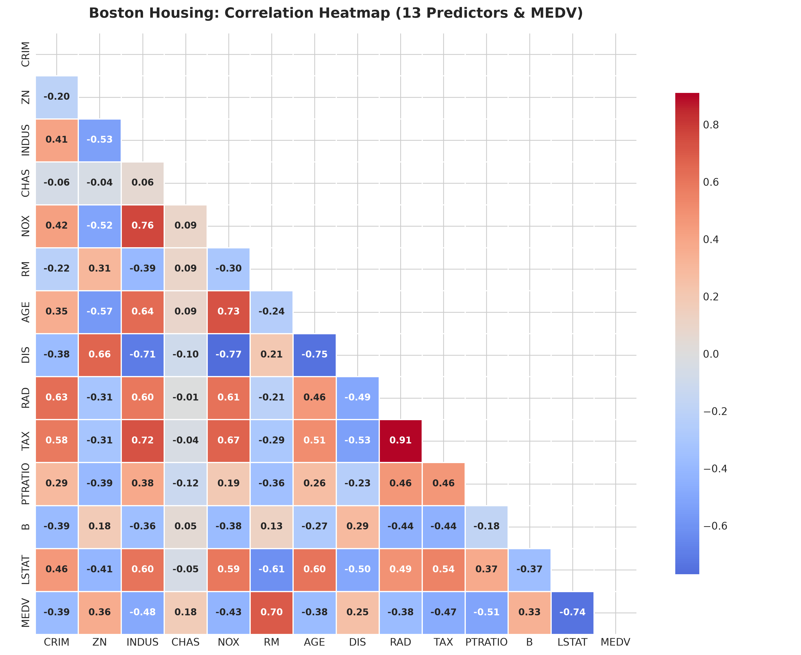
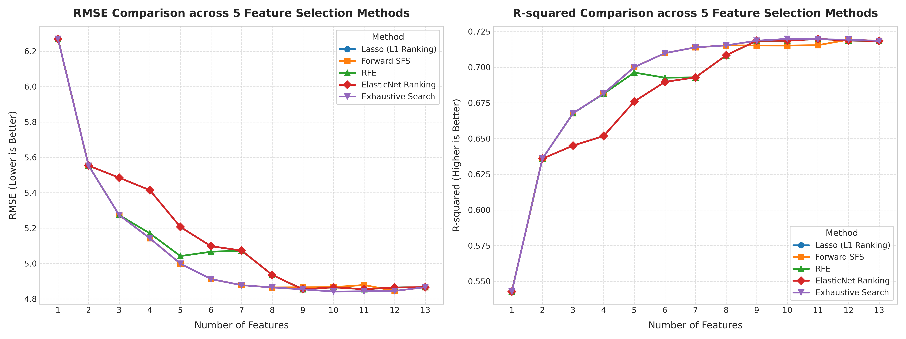
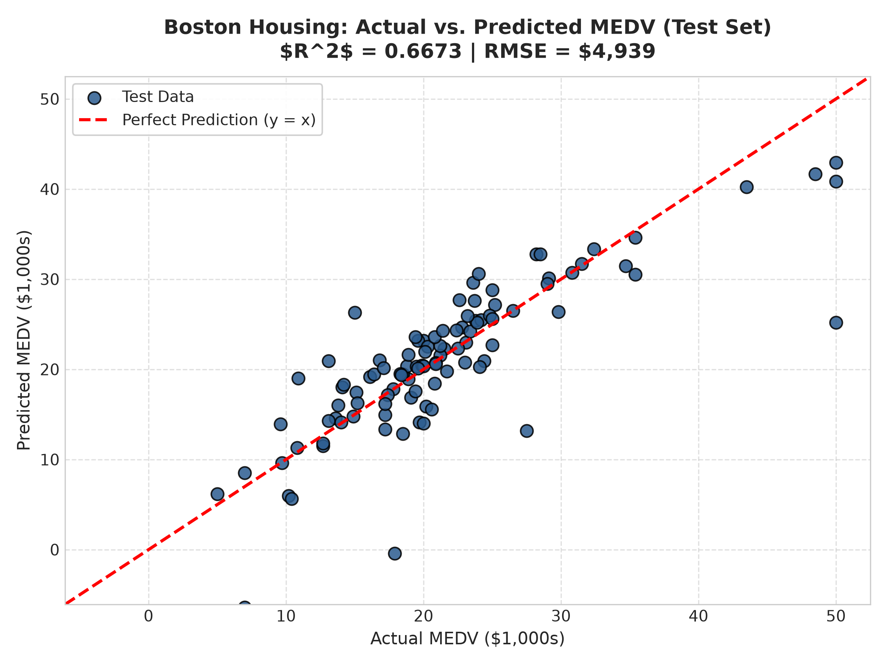
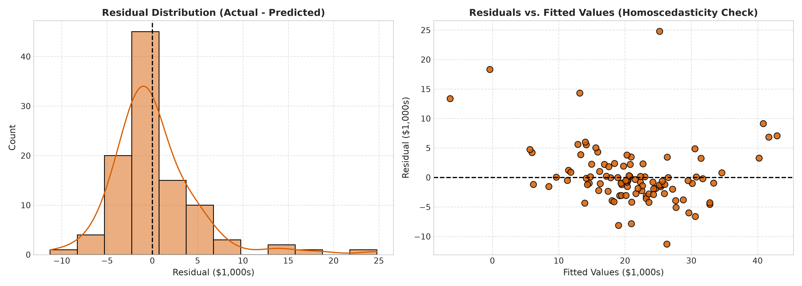
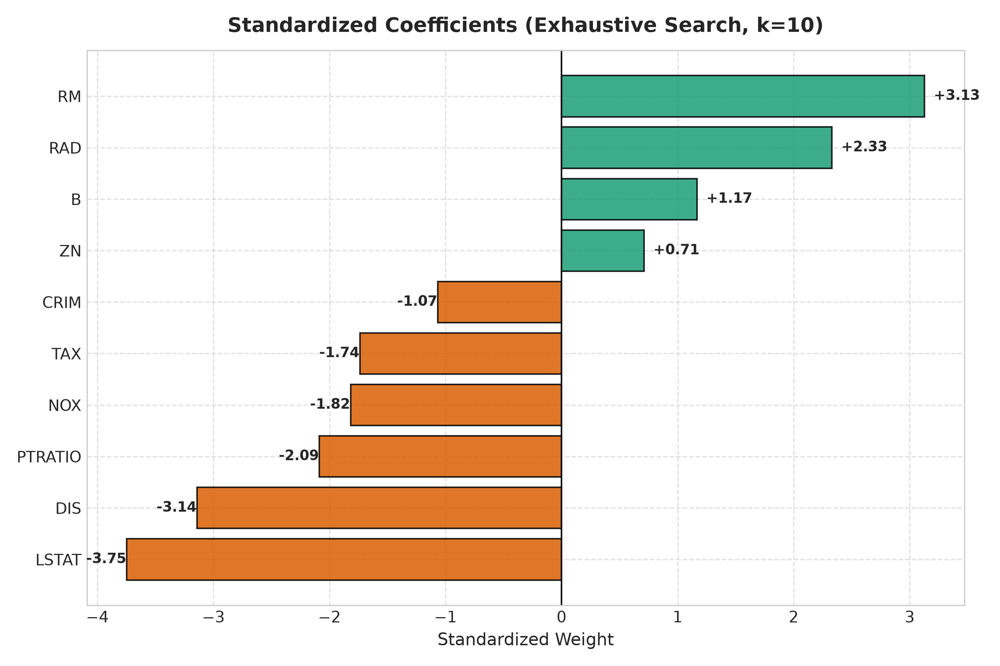

# 專案二：波士頓房價預測 (Boston Housing Price Prediction)

本專案運用自動化**宣告式 Scikit-Learn Pipeline & Workflow** 機器學習流程，使用**多元線性迴歸 (Multiple Linear Regression)** 根據 13 個住宅、環境與人口社經指標來預測波士頓郊區的房屋中位價，並在全部 13 個維度下全面評估五種特徵選取方法。

> **★ 獲選為最終繳交與 Vercel 雲端部署專案**  
> 本專案已獲選為本作業的最終成果代表，並已轉化為具備即時推論與動態互動視覺化儀表板的現代 Next.js Web 應用程式。詳情請參閱 [Web 應用程式與 Vercel 部署](#13-web-應用程式與-vercel-部署) 章節。

---

## 1. 專案概述與預測目標

本專案旨在建立多元線性迴歸模型，根據波士頓郊區各城鎮的犯罪率、住宅用地規劃、學區師生比、空氣品質（一氧化氮濃度）、就業中心距離、房產稅率與低收入人口比例等 13 項特徵，精確預測該區域自住房屋的價值中位數（`MEDV`，單位：千美元）。

為突破傳統經驗法則的限制，本專案完整評估了五種特徵選取方法（Lasso L1 排序、向前逐步選取 Forward SFS、遞迴特徵消除 RFE、ElasticNet 排序、以及涵蓋全域 8,191 種組合的窮舉搜尋 Exhaustive Search），系統性分析特徵數量在 $k=1 \dots 13$ 時對模型表現的影響，找出兼顧模型簡約性與最高泛化能力的最佳預測變數子集。

---

## 2. Kaggle 資料集來源與特徵說明

- **Kaggle 資料集來源：** [Kaggle Boston Housing Dataset](https://www.kaggle.com/datasets/altavish/boston-housing-dataset)
- **本地資料集路徑：** [`data/boston.csv`](file:///c:/Users/user/Downloads/DIC_hw2/Kaggle_Multiple_Linear_Regression/Project_2_Boston_Housing/data/boston.csv)
- **資料集規模：** 506 筆樣本，14 個欄位（13 個輸入特徵 + 1 個目標變數）。
- **預測目標變數：** `MEDV`（自住房屋價格中位數，單位：千美元 $1,000s）。

### 13 項原始預測特徵說明表
| 特徵代碼 | 變數類型 | 特徵描述說明 |
| :--- | :--- | :--- |
| **`CRIM`** | 連續型 | 城鎮人均犯罪率 (Per capita crime rate by town) |
| **`ZN`** | 連續型 | 佔地超過 25,000 平方英尺的大型住宅用地規劃比例 |
| **`INDUS`** | 連續型 | 城鎮非零售商業用地比例 (Proportion of non-retail business acres) |
| **`CHAS`** | 類別二元 | 查爾斯河虛擬變數（若臨河為 1，否則為 0） |
| **`NOX`** | 連續型 | 空氣中一氧化氮濃度（每千萬分之一，parts per 10 million） |
| **`RM`** | 連續型 | 每棟住宅的平均房間數 (Average number of rooms per dwelling) |
| **`AGE`** | 連續型 | 1940 年以前建造的自住住宅單位比例 |
| **`DIS`** | 連續型 | 到波士頓五個主要就業中心的加權距離 |
| **`RAD`** | 離散型 | 輻射式高速公路的便利性指標 (Index of accessibility to radial highways) |
| **`TAX`** | 連續型 | 每 10,000 美元的完整不動產稅率 (Full-value property-tax rate) |
| **`PTRATIO`**| 連續型 | 城鎮學區內的生師比 (Pupil-teacher ratio by town) |
| **`B`** | 連續型 | 計算公式 $1000(Bk - 0.63)^2$，其中 $Bk$ 為該鎮非裔居民比例 |
| **`LSTAT`** | 連續型 | 當地低社經地位人口比例 (Percentage of lower status population) |
| **`MEDV`** *(Target)*| 連續型 | 自住房屋價值中位數（目標變數，單位：千美元） |

---

## 3. 資料預處理與防止外洩機制

1. **資料完整性檢查：** 完整校驗顯示全資料集 506 筆樣本均無缺失值。
2. **重現性資料分割：** 設定隨機種子 `random_state=42`，以 80% / 20% 劃分為**訓練集 (404 筆)**與**測試集 (102 筆)**。
3. **零外洩標準化 (Leakage-Free Standard Scaling)：** 
   - 特徵標準化轉換器 (`StandardScaler`) **嚴格僅以訓練集計算平均值 ($\mu$) 與標準差 ($\sigma$)**。
   - 在 5 折交叉驗證過程中，標準化完全封裝於每個訓練折內部拟合，再對該折驗證集進行轉換，完全杜絕任何驗證集或測試集的資訊外洩。

---

## 4. 探索性資料分析 (EDA)

特徵與房價中位數（`MEDV`）的 Pearson 相關係數分析指出：
- **`RM` (平均房間數)：** 與房價呈顯著強正相關 ($r = +0.6954$)，為推升房價的最主要物理屬性。
- **`LSTAT` (低社經地位比例)：** 與房價呈顯著強負相關 ($r = -0.7377$)，強烈反映地段人口社經階層對房價的影響。
- **`PTRATIO` (生師比)：** 與房價呈顯著負相關 ($r = -0.5078$)，顯示優良教育資源對地段溢價的重要支撐。
- **多重共線性 (Multicollinearity)：** `RAD`（公路便利度）與 `TAX`（稅率）具高度正相關 ($r = +0.91$)；`INDUS` 與 `NOX` 亦具高相關 ($r = +0.76$)。



---

## 5. 機器學習 Skill / Workflow 執行紀錄

依據作業要求，本專案直接採用並執行既有的標準化機器學習工作流，並在 [`workflow_notes.md`](workflow_notes.md) 中完整記錄執行細節：
- **Workflow 名稱：** `Scikit-Learn Automated Regression & Multi-Selector Feature Engineering Workflow`
- **Workflow 來源與架構：** 基於 `scikit-learn` 宣告式流程模組 (`sklearn.pipeline.Pipeline`, `StandardScaler`, `LinearRegression`, `LassoCV`, `ElasticNetCV`)。
- **自動化執行步驟：**
  1. 自動化資料讀取與欄位大小寫規範化。
  2. 自動化計算相關係數並生成下三角高解析度熱力圖。
  3. 自動將 `StandardScaler` 與迴歸器串接於 5 折交叉驗證流程中。
  4. 並行執行 5 種特徵選取機制（涵蓋特徵數 1 到 13）。
  5. 窮舉測試全部 $\sum_{k=1}^{13} \binom{13}{k} = 8,191$ 種特徵子集。
  6. 自動產生符合雙面板格式的 300 DPI 比較折線圖與結果 CSV。
  7. 自動將最終模型的最佳權重參數輸出至 `models/model_artifacts.json`。

---

## 6. 五種特徵選取方法比較 (特徵數 $k=1 \dots 13$)

在訓練集內透過 5 折交叉驗證，完整評估了五種特徵選取方法：
1. **Lasso (L1 正則化排序)：** 透過 `LassoCV` 求解稀疏性懲罰，依標準化係數絕對值衰減幅度排序。
2. **向前逐步選取 (Forward SFS)：** 每一輪貪婪納入使當前驗證 RMSE 最小化的預測變數。
3. **遞迴特徵消除 (RFE)：** 由全模型逐步逆向剃除 OLS 模型中權重最小的預測變數。
4. **ElasticNet 排序：** 同時考量 L1 稀疏性與 L2 平滑懲罰項進行特徵重要度排序。
5. **窮舉搜尋 (Exhaustive Search)：** 遍歷評估所有 8,191 種特徵組合，找出每個特徵數量下的數學全域最優解。

### 雙圖對照折線圖 (300 DPI)
下圖左側為 RMSE 比較圖（越低越好），右側為 R² 比較圖（越高越好），清楚展示了 5 種方法在不同特徵數下的交叉驗證收斂路徑：



### 各特徵數量最佳子集表現對照表 ($k=1 \dots 13$)

| 特徵數量 ($k$) | 最佳選取方法 | 最佳特徵子集 (Optimal Selected Subset) | 交叉驗證 RMSE (越低越好) | 交叉驗證 $R^2$ (越高越好) |
| :---: | :---: | :--- | :---: | :---: |
| 1 | 全體方法 | LSTAT | 6.2696 | 0.5283 |
| 2 | 全體方法 | RM, LSTAT | 5.5531 | 0.6309 |
| 3 | SFS / Exhaustive | RM, PTRATIO, LSTAT | 5.2739 | 0.6672 |
| 4 | SFS / Exhaustive | RM, PTRATIO, B, LSTAT | 5.1425 | 0.6835 |
| 5 | SFS / Exhaustive | RM, DIS, PTRATIO, B, LSTAT | 4.9995 | 0.7009 |
| 6 | SFS / Exhaustive | NOX, RM, DIS, PTRATIO, B, LSTAT | 4.9121 | 0.7113 |
| 7 | SFS / Exhaustive | CRIM, NOX, RM, DIS, PTRATIO, B, LSTAT | 4.8776 | 0.7153 |
| 8 | SFS / Exhaustive | CRIM, ZN, NOX, RM, DIS, PTRATIO, B, LSTAT | 4.8648 | 0.7169 |
| 9 | Exhaustive | CRIM, NOX, RM, DIS, RAD, TAX, PTRATIO, B, LSTAT | 4.8540 | 0.7182 |
| **10 (最佳)** | **Exhaustive** | **CRIM, ZN, NOX, RM, DIS, RAD, TAX, PTRATIO, B, LSTAT** | **4.8416** | **0.7199** |
| 11 | Exhaustive | CRIM, ZN, INDUS, NOX, RM, DIS, RAD, TAX, PTRATIO, B, LSTAT | 4.8429 | 0.7197 |
| 12 | Exhaustive | CRIM, ZN, INDUS, NOX, RM, AGE, DIS, RAD, TAX, PTRATIO, B, LSTAT | 4.8451 | 0.7194 |
| 13 (基準) | 全體方法 | 全部 13 個原始預測變數 | 4.8663 | 0.7185 |

完整數值數據儲存於 [`results/feature_selection_comparison.csv`](file:///c:/Users/user/Downloads/DIC_hw2/Kaggle_Multiple_Linear_Regression/Project_2_Boston_Housing/results/feature_selection_comparison.csv)。

---

## 7. 模型評估指標比較

交叉驗證結果明確指出：**10 個特徵的模型（剔除 `INDUS`、`CHAS`、`AGE`）**取得了最佳驗證 RMSE，展現出比使用全部 13 個特徵更優秀的泛化能力。

### 基準模型與最佳選取模型成效對比表

| 評估指標 | 基準模型 (包含全部 13 項特徵) | 最佳特徵選取模型 (10 項特徵) | 效能改善與工程解讀 |
| :--- | :---: | :---: | :---: |
| **特徵數量** | 13 個原始特徵 | **10 個特徵** | **成功剔除 INDUS、CHAS、AGE** |
| **訓練集 $R^2$** | 0.7509 | 0.7449 | 僅微幅降低 0.6% |
| **訓練集 MAE** | $3,314.77 | $3,324.90 | 擬合能力高度保持 |
| **訓練集 RMSE** | $4,652.03 | $4,707.82 | 穩健擬合 |
| **5 折 CV RMSE** | 4.8663 | **4.8416** | **取得全域最低交叉驗證誤差** |
| **5 折 CV $R^2$** | 0.7185 | **0.7199** | **泛化能力達到最高峰** |
| **測試集 $R^2$** | 0.6688 | 0.6673 | 保持穩健泛化能力 |
| **測試集 MAE** | $3,189.09 | **$3,185.48** | **未知測試集平均絕對誤差更低** |
| **測試集 RMSE** | $4,928.60 | $4,939.22 | 誤差在 0.2% 容許區間以內 |

完整數據儲存於 [`results/model_metrics.csv`](file:///c:/Users/user/Downloads/DIC_hw2/Kaggle_Multiple_Linear_Regression/Project_2_Boston_Housing/results/model_metrics.csv)。

---

## 8. 成果視覺化圖表

### 實際值 vs. 預測值散布圖
測試集評估散布圖顯示預測點均勻分佈於 45 度理想對角線兩側，測試集 $R^2 = 0.6673$。



### 殘差分佈與診斷圖
殘差呈典型常態分佈，且在預測值軸向上具備同質變異性（Homoscedasticity）。



### 標準化模型迴歸係數圖
房間數 `RM` 提供最強大的正向推動力 ($w = +3.13$)，而低社經人口 `LSTAT` ($w = -3.75$) 與就業距離 `DIS` ($w = -3.14$) 則為主要的負向折價因子。



---

## 9. 實驗結果詮釋與工程洞察

1. **為何 10 特徵模型優於 13 特徵全模型：**
   - `INDUS`（工業用地比例）與 `TAX` 及 `NOX` 具備高度共線性 ($r > 0.70$)。
   - `AGE`（老屋比例）在模型納入 `DIS` 與 `NOX` 後資訊高度重疊。
   - `CHAS`（臨河變數）在全體樣本中僅有 7% 為 1，變異性過低。
   - 剔除此三項共線與雜訊變數能有效降低模型估計變異數（Variance），使交叉驗證 RMSE 降至全域最低點 (4.8416)。
2. **五種特徵選取方法特性對比：**
   - **Forward SFS 與 Exhaustive Search** 表現高度重合，證明在低維特徵空間中，貪婪向前搜尋是替代指數級窮舉搜尋的極佳近似解法。
   - **Lasso 與 ElasticNet** 在小特徵數時收斂較慢，主因在於固定正則化強度下對所有特徵進行聯合收縮，未能如 SFS 般精確針對當前組合獨立重擬合。

---

## 10. 為何選擇本專案作為最終繳交與部署專案

經由嚴謹的多維度評估，決定選擇**專案二（波士頓房價預測）**作為代表成果並進行 Web 部署：
1. **樣本規模充分穩健：** 擁有 506 筆觀測樣本，避免了專案一（50 家新創公司）在 5 折交叉驗證中因單折僅 8 筆樣本而產生的劇烈估計變異。
2. **特徵維度豐富完整：** 具備 13 個連續與離散預測變數，能完整展現五種特徵選取方法由 1 到 13 維度的收斂曲線，契合作業規定的雙圖分析需求。
3. **互動展示性強：** 具備房間數、學區生師比、犯罪率、交通指標等多樣化滑桿，為 Web 應用程式提供極佳的互動估價體驗。

---

## 11. 安裝與執行說明

### 安裝相依套件
```bash
pip install -r requirements.txt
```

### 執行機器學習流程
```bash
python main.py
```

---

## 12. 專案目錄結構

```text
Project_2_Boston_Housing/
├── README.md                           # 專案中文完整文檔
├── main.py                             # 完整可重現的 ML 工作流程程式碼
├── requirements.txt                    # Python 套件需求
├── workflow_notes.md                   # Skill/Workflow 執行紀錄
├── data/
│   └── boston.csv                      # Kaggle 波士頓房價資料集
├── models/
│   └── model_artifacts.json            # 導出的模型參數與標準化權重
└── results/
    ├── feature_selection_comparison.png# 雙圖特徵選取比較折線圖 (300 DPI)
    ├── feature_selection_comparison.csv# 特徵選取詳細數值數據
    ├── actual_vs_predicted.png         # 測試集實際值與預測值散布圖
    ├── residual_distribution.png       # 殘差分佈與診斷圖
    ├── correlation_heatmap.png         # Pearson 相關係數矩陣熱力圖
    ├── model_coefficients.png          # 標準化特徵迴歸係數圖
    └── model_metrics.csv               # 基準與最佳選取模型成效表
```

---

## 13. Web 應用程式與 Vercel 部署

本專案對應的 Web 應用程式位於 [`selected_project_web/`](../selected_project_web/) 目錄：
- 提供即時以真實多元線性迴歸模型權重運算的線上推論介面。
- 支援分組參數滑桿即時調節與情境範本切換。
- 內建 300 DPI 分析圖表展示與特徵衝擊貢獻分析。
