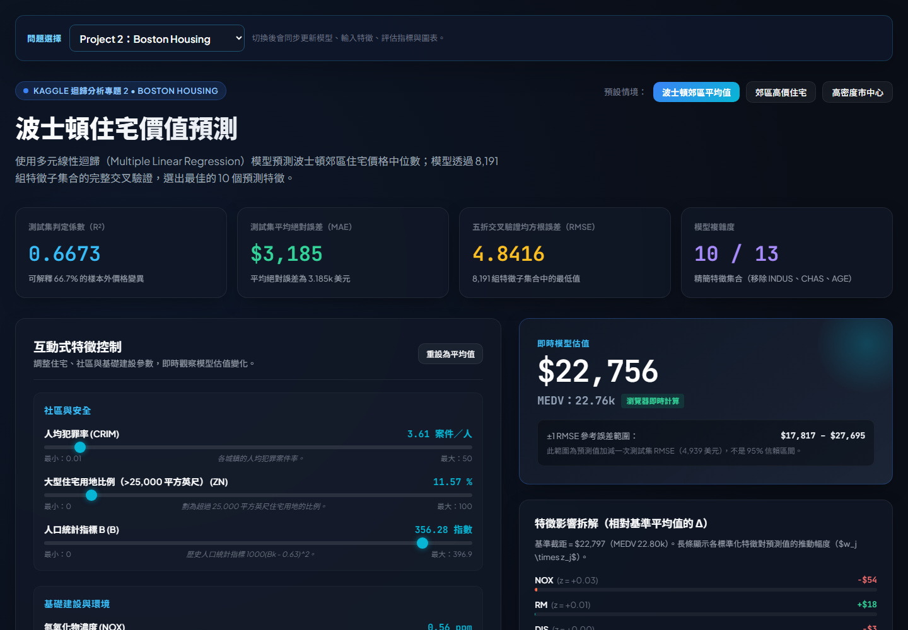
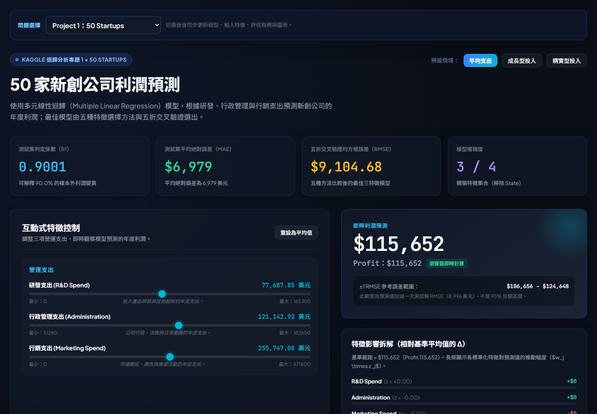

# 多元線性迴歸雙專題

本資料夾包含兩個多元線性迴歸專題，以及一個部署於 GitHub Pages 的互動式成果網站。網站可透過上方下拉選單切換 `Project 1：50 Startups` 與 `Project 2：Boston Housing`。

## 線上成果網站

**[開啟互動式預測網站](https://cheeefds.github.io/DIC2_AIOT/)**

### Project 2：Boston Housing

使用多元線性迴歸模型，呈現波士頓住宅價值預測、模型評估指標與互動式特徵控制。



### Project 1：50 Startups

使用多元線性迴歸模型，呈現新創公司利潤預測、特徵影響與模型比較結果。



## 專案內容

| 資料夾 | 說明 |
| --- | --- |
| `Kaggle_Multiple_Linear_Regression/Project_1_50_Startups/` | 50 Startups 資料分析、特徵選擇與模型評估 |
| `Kaggle_Multiple_Linear_Regression/Project_2_Boston_Housing/` | Boston Housing 資料分析、特徵選擇與模型評估 |
| `Kaggle_Multiple_Linear_Regression/selected_project_web/` | 可切換兩個專題的互動式預測與成果展示網站 |

## 網站本機預覽

```powershell
cd Kaggle_Multiple_Linear_Regression\selected_project_web
npm ci
npm run dev
```

接著開啟 <http://localhost:3000>。詳細建置與驗證方式請參考 [`selected_project_web/README.md`](Kaggle_Multiple_Linear_Regression/selected_project_web/README.md)。

## 部署到 GitHub Pages

專案根目錄已包含 `.github/workflows/deploy-pages.yml`。每次 push 到 `main` 分支時，GitHub Actions 會自動建置並部署網站。

1. 在 GitHub 建立新的 repository，不要預先加入 README 或 `.gitignore`。
2. 在 `DIC_hw2` 根目錄初始化並推送：

   ```powershell
   git init
   git add .
   git commit -m "Prepare regression project website"
   git branch -M main
   git remote add origin https://github.com/<你的帳號>/<repository名稱>.git
   git push -u origin main
   ```

3. 進入 GitHub repository 的 `Settings` → `Pages`。
4. 在 `Build and deployment` 的 `Source` 選擇 `GitHub Actions`。
5. 到 `Actions` 頁面等待 `Deploy Next.js site to GitHub Pages` 完成。

部署網址格式：

```text
https://<你的帳號>.github.io/<repository名稱>/
```

網站設定會在 GitHub Actions 建置時自動讀取 repository 名稱並加入資源路徑，不需要修改程式碼。

## Python 分析

兩個分析專案各自提供 `requirements.txt`：

```powershell
cd Kaggle_Multiple_Linear_Regression\Project_2_Boston_Housing
python -m pip install -r requirements.txt
python main.py
```

執行後的模型資料位於 `models/`，分析圖表與評估結果位於 `results/`。
